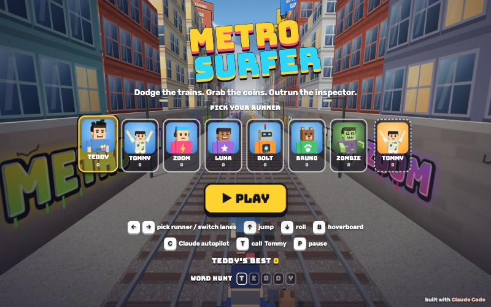

# Metro Surfer

[](https://adong.github.io/metro-surfer/)

Press **?** any time (or tap the round **?** button on the left edge) to see the keys. The game waits while you look.

A 3D endless runner in the spirit of Subway Surfers. It's built with Claude Code from plain JavaScript and Three.js.
There are no image, model, or audio files: every texture is painted on a canvas, every model is built from boxes, and every sound is synthesised.

## Play

- **Double-click `index.html`.** It works offline because Three.js and the shared kit are copied into `kit/`.
- **Send one file:** `dist/metro-surfer.html` is the whole game inlined, about 700 KB. AirDrop or email it, then open it in a browser.
- Rebuild that file after any edit: `python3 kit/tools/bundle.py .`
- Scores, the chosen runner, Tommy's card and Word Hunt progress are saved per browser *and* per way of opening the game, so `index.html` and `dist/metro-surfer.html` each keep their own.

| Keys | Touch | |
|---|---|---|
| ← → or A D | swipe left / right | switch lanes (on the title screen: pick a runner) |
| ↑ W Space | swipe up | jump (press just before landing to buffer it) |
| ↓ S | swipe down | roll; in mid-air it slams you down |
| B | double-tap or 🛹 button | hoverboard: survives one crash |
| C | 🤖 button | Claude autopilot on/off; any arrow takes the wheel back |
| T | buddy button (bottom right) | call your buddy, any time and as often as you like |
| P / Esc | ❚❚ button | pause |
| H | 🏠 MENU (on the pause and game-over screens) | back to the title screen to pick another runner |
| M | 🔊 button | sound on/off |

## Runners, Tommy, the zombie and the Word Hunt

- **Pick your runner** on the title screen. TEDDY and TOMMY are modelled on their photos. Teddy has black spiky hair, a big grin, a blue brick-wall tee and red sneakers. Tommy has short black hair, a mint space tee with a UFO beaming up a dinosaur, cream joggers, and his favourite Y pose (both arms up, peace fingers). The others are ZOOM, LUNA, BOLT the robot and BRUNO the bear. Each runner keeps its own best score, so everyone in the family can have one.
- **ZOMBIE** (Tommy's idea): a cartoon zombie shambles right up to the screen with a groan and a "BOO!". You get this two ways: by picking the ZOMBIE runner (then you run as him, arms out), or by running into a 🧟 zombie card on the track. When you hit the card, the run freezes until the scare is over and then carries on with a moment of protection, so it can never cost you a run.
- **Your buddy is the other brother:** Tommy runs along with every runner, except when Tommy is the runner, when Teddy comes instead. Tap the buddy card on the title screen, the buddy button during a run, or press T, and he runs in doing his signature pose (Tommy's Y, Teddy's wave). He follows your runner for about 10 s, copying their jumps and rolls, and hands over a treat (🍦 💧 🧃 🍪 🍉 🍌) that your runner carries. Then he poses again and drops back. Tap again while he's there and he poses and hands over another treat; tap after he's gone and he comes right back.
  **Your buddy has your back:** while he's running with you (until he starts dropping back, about 9.6 s; his bar shows the time left), crashing into a train or barrier doesn't end the run. The obstacle bursts, "TOMMY SAVED YOU!" (or "TEDDY SAVED YOU!") pops up and he does his pose. Side bumps don't bring the inspector, and your hoverboard isn't used up. Calling him again keeps the protection going.
- **Word Hunt:** letter tiles for the current word appear on the track, one at a time and in order. Spell the word for 100 coins plus its reward. TEDDY gives a hoverboard, TOMMY makes your buddy come running, METRO gives 2× score, SURF super sneakers, ZOMBIE a magnet and CLAUDE a jetpack. Progress carries over between runs.
- **Make it yours:** the runners (Teddy and Tommy included) and who comes along as whose buddy live in the shared kit, `~/claude-games/kit/roster.js`, so every Teddy & Tommy game gets the same characters. Copy an entry there to add a player (say, Dad), then run `python3 ../kit/tools/sync.py .` here. Metro's own word list and the inspector are in `js/content.js`.
- **Signature moves:** when Teddy is the buddy he shadow-boxes like Mike Tyson (jab, straight) to say hi and when he saves you, and says bye with a basketball jump shot (🏀 … SWISH!). Tommy's move is his Y pose.

## What's in it

- **Obstacles:** 3 lanes, with trains parked or rolling toward you. A rolling train has its headlights on and sounds its horn when it starts moving. There are also ramps up onto train roofs, barriers you jump, and barriers you roll under.
- **Hits:** clipping the side of a train is a stumble, and the inspector and his dog close in. Stumble twice and you're busted.
- **Power-ups:** 🧲 coin magnet, 🚀 jetpack (with a coin trail in the sky), 👟 super sneakers (high enough to jump onto trains), 2× score, and 🛹 extra hoverboards.
- **Speed and scenery:** a kid-friendly pace that eases from 15 m/s toward 28. Graffiti walls (look for TEDDY), rooftop billboards, water towers, and a synthesised Am–F–C–G soundtrack.
- **Saving:** your best score is saved in the browser. Runs where the autopilot drove don't count toward it.
- **Speed:** every run starts at 15 m/s and speeds up gently on its own: about 20 after a minute, 23 after two, never past 28. To change it, edit `START_SPEED`, `TOP_SPEED` and `RAMP_TIME` at the top of `js/game.js`. The Space bar only jumps: holding it gives one jump and doesn't change your speed.

## The autopilot (and how the level generator is tested)

Ten times a second, the autopilot simulates 75 possible futures about 1.2 s ahead. Each future is a move now, plus maybe a second move a moment later. They use the same physics function as the player, and it makes the first move of the best one. The title screen uses it to play in the background.

Every row of obstacles has a guaranteed **safe lane** that moves at most one lane per row. Rolling trains are never placed where they could sweep into it. You can check that the generator is fair from the browser console:

```js
metro.soak(300)                 // 5 min of autopilot play, headless; logs every crash and stumble
metro.soak(60, { auto: false }) // nobody steering: proves the test can actually fail
```

At the last check (kid-friendly speeds), 6 × 5-minute runs gave 0 crashes and 0 stumbles. With the autopilot off, the same test logged 13 crashes in its first minute.

## Files

```
index.html        page, HUD and screens (CSS inline)
js/content.js     the inspector and the Word Hunt words
js/art.js         the world: track, buildings, trains, barriers, pickups, the dog
js/game.js        physics, level generator, autopilot, buddy, input, main loop
kit/              a copy of the shared Claude Games kit: Three.js r149, characters (people.js, roster.js),
                  portraits, synth sound, and tools/bundle.py. Edit ~/claude-games/kit, then re-sync here.
dist/metro-surfer.html   the single-page build
```
